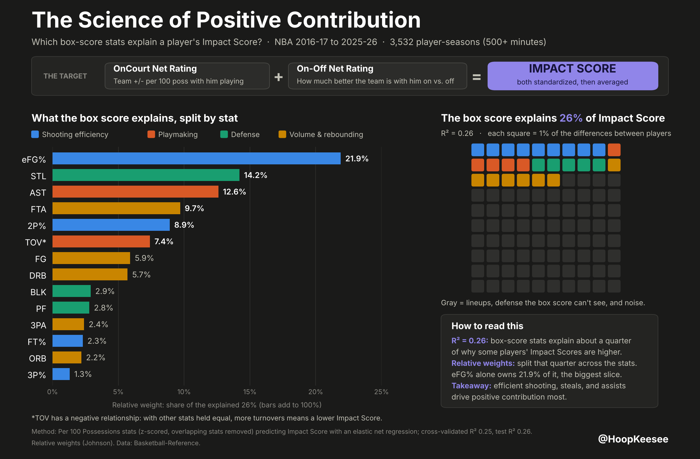
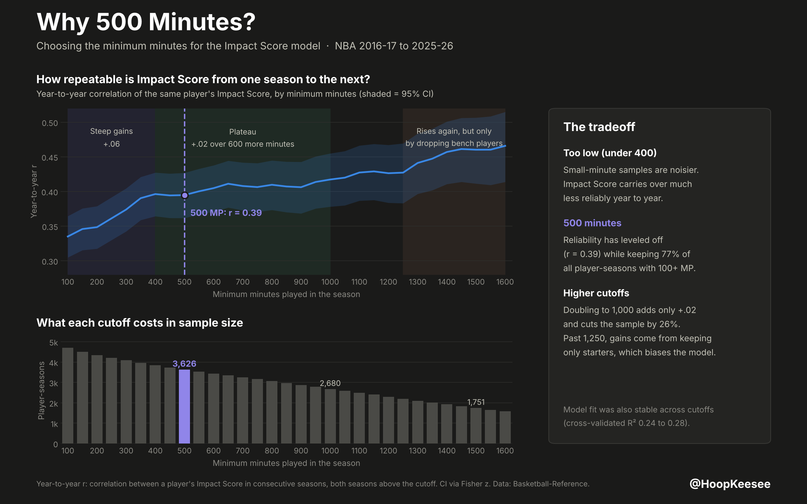
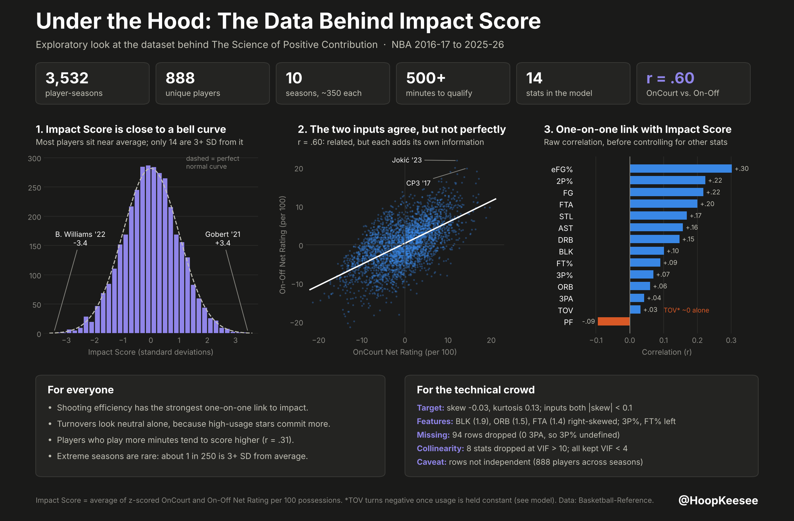

# NBA Net Rating and On-Off Model

**Which Per 100 Possessions stats are significantly associated with an NBA player's on-court impact, and how much of that impact can the box score explain?**

Box-score stats explain about **26%** of the variance (test R² 0.26; full-sample R² 0.27) in **Impact Score**, a composite of a player's OnCourt Net Rating and On-Off Net Rating, across 3,532 player-seasons from 2016-17 to 2025-26. Shooting efficiency (eFG%) is the largest contributor; steals, assists and free-throw attempts follow. Turnovers look neutral on their own but become the largest single negative effect once usage is held constant.



---

## Contents

- [Key results](#key-results)
- [Data](#data)
- [Method](#method)
- [Evaluation](#evaluation)
- [Exploratory data analysis](#exploratory-data-analysis)
- [Takeaways](#takeaways)
- [Limitations](#limitations)
- [Reproducing the analysis](#reproducing-the-analysis)
- [Repository structure](#repository-structure)

---

## Key results

### Standardized coefficients (OLS)

| Stat | Estimate | Std. Error | t value | Significance |
|:-----|-----:|-----:|-----:|-----:|
| AST | 0.348 | 0.024 | 14.283 | *** (p < 0.001) |
| TOV | -0.389 | 0.028 | -13.849 | *** (p < 0.001) |
| STL | 0.213 | 0.016 | 13.491 | *** (p < 0.001) |
| eFG% | 0.305 | 0.026 | 11.645 | *** (p < 0.001) |
| FTA | 0.243 | 0.023 | 10.413 | *** (p < 0.001) |
| DRB | 0.174 | 0.022 | 7.895 | *** (p < 0.001) |
| 3PA | 0.145 | 0.022 | 6.680 | *** (p < 0.001) |
| BLK | 0.074 | 0.020 | 3.659 | *** (p < 0.001) |
| FT% | 0.042 | 0.018 | 2.331 | * (p < 0.05) |
| PF | -0.030 | 0.019 | -1.569 | n.s. |
| FG | 0.031 | 0.025 | 1.220 | n.s. |
| 2P% | -0.026 | 0.026 | -0.967 | n.s. |
| ORB | -0.004 | 0.028 | -0.156 | n.s. |
| 3P% | 0.003 | 0.018 | 0.145 | n.s. |

Classical OLS standard errors on z-scored variables. HC3 heteroskedasticity-robust standard errors give the same significance conclusions (FT% p = .039); both are in [`results/ols_coefficients.csv`](results/ols_coefficients.csv). Full R-style output: [`results/ols_summary.txt`](results/ols_summary.txt).

### Relative weights: share of the explained 26%

| Stat | % of R² |
|:---:|:---:|
| eFG% | 21.9% |
| STL | 14.2% |
| AST | 12.6% |
| FTA | 9.7% |
| 2P% | 8.9% |
| TOV* | 7.4% |
| FG | 5.9% |
| DRB | 5.7% |
| BLK | 2.9% |
| PF | 2.8% |
| 3PA | 2.4% |
| FT% | 2.3% |
| ORB | 2.2% |
| 3P% | 1.3% |

\*TOV has a negative relationship: with other stats held equal, more turnovers means a lower Impact Score.

Relative weights (Johnson, 2000) split R² across correlated predictors and sum to the model R². Each weight was also tested against a random noise variable over 5,000 bootstrap resamples (Tonidandel, LeBreton & Johnson, 2009); all 14 exceed it, which at n = 3,532 says little, so the table above is ranked by share of R².

---

## Data

- **Source:** [Basketball-Reference](https://www.basketball-reference.com) league Per 100 Possessions tables and Play-by-Play (+/-) tables, 2016-17 to 2025-26 regular seasons.
- **Target inputs:** OnCourt (team net rating per 100 possessions with the player on the floor) and On-Off (OnCourt minus team net rating with the player off the floor).
- **Traded players:** the season-total row is used.
- **Sample:** 3,626 player-seasons met the 500-minute cutoff; 94 were dropped for having no 3-point attempts (3P% undefined), leaving **3,532 player-seasons from 888 players**.
- **Minutes cutoff:** year-to-year reliability of Impact Score leveled off between 400 and 500 minutes (r ≈ .40). 500 was chosen as a conservative, conventional cutoff. Cross-validated R² was stable across cutoffs from 250 to 1,250 minutes (0.24 to 0.28).



See [`data/README.md`](data/README.md) for the data dictionary. The data files themselves are not included in this repository; see [Reproducing the analysis](#reproducing-the-analysis).

---

## Method

### Preparation

1. Gathered OnCourt Net Rating and On-Off Net Rating for each player-season.
2. Normalized OnCourt and On-Off separately, averaged them, then normalized the average. The result is **Impact Score**.
3. Normalized all 22 Per 100 stats (G, GS, MP, ORtg and DRtg excluded).
4. Removed collinear stats one at a time (highest VIF first, training set only) until every VIF was 10 or less, leaving 14 stats. A threshold of 5 removes the same stats; the largest remaining VIF is 3.81.

| Order | Removed | VIF when removed |
|:---:|:---:|:---:|
| 1 | FGA | 9,605 |
| 2 | PTS | 8,287 |
| 3 | TRB | 5,900 |
| 4 | 2P | 2,756 |
| 5 | 2PA | 135 |
| 6 | 3P | 100 |
| 7 | FT | 78 |
| 8 | FG% | 42 |

### Model

- **Multiple linear regression with an elastic net** to limit overfitting (α = 0.0018, l1_ratio = 0.95, mostly lasso), tuned by 5-fold cross-validation over α ∈ 10^[-4, 0] and l1_ratio ∈ {0.1, 0.3, 0.5, 0.7, 0.9, 0.95, 1.0}.
- **80/20 train/test split** (2,826 / 706).
- **Repeated 5-fold cross-validation** (20 repeats) on the training set.
- **Full-sample OLS** for standardized β, standard errors and p-values (classical and HC3).
- **Relative weights analysis** (Johnson, 2000) for each stat's share of R², with bootstrap significance testing.

---

## Evaluation

| Metric | Value |
|---|---|
| Train R² (n = 2,826) | 0.26 |
| Test R² (n = 706) | 0.26 |
| Train RMSE / Test RMSE | 0.87 / 0.81 |
| Repeated 5-fold CV R² | 0.25 (SD 0.03) |
| Repeated 5-fold CV RMSE | 0.88 |
| Full-sample OLS R² / Adj. R² | 0.27 / 0.26 |
| OLS F-test | F(14, 3517) = 90.8, p < .001 |

Train, test and cross-validated R² are nearly identical, so the model is not overfitting. The elastic net's coefficients are almost identical to OLS because VIF pruning already handled the collinearity.

---

## Exploratory data analysis

| Player-seasons | Players | Seasons | Min. minutes | Stats in model | OnCourt vs. On-Off |
|:---:|:---:|:---:|:---:|:---:|:---:|
| 3,532 | 888 | 10 (~350 each) | 500 | 14 | r = .60 |

- Impact Score is close to normal (skew -0.03, kurtosis 0.13); 14 player-seasons are beyond 3 SD. Highest: Rudy Gobert 2020-21 (+3.44), Chris Paul 2016-17, Nikola Jokić 2022-23. Lowest: Brandon Williams 2021-22 (-3.43).
- OnCourt and On-Off correlate at r = .60: related enough to combine, different enough that each adds information.
- Minutes played correlate with Impact Score (r = .31).
- BLK, ORB and FTA are right-skewed; 3P% and FT% are left-skewed (low-volume shooters).

**Raw correlation with Impact Score (before controlling for other stats)**

| Stat | r | Stat | r |
|:---:|:---:|:---:|:---:|
| eFG% | +.30 | BLK | +.10 |
| 2P% | +.22 | FT% | +.09 |
| FG | +.22 | 3P% | +.07 |
| FTA | +.20 | ORB | +.06 |
| STL | +.17 | 3PA | +.04 |
| AST | +.16 | TOV* | +.03 |
| DRB | +.15 | PF | -.09 |

\*TOV turns negative once usage is held constant (see model).



---

## Takeaways

1. **eFG% is the top variable by relative weight**, accounting for 21.9% of the explained 26%.
2. **Four stats explain over half of the explained variance:** eFG%, STL, AST and FTA (58.4% combined).
3. **The box score has a ceiling.** Per-possession box-score stats explain about a quarter of Impact Score, though the model is clearly significant.
4. **Turnovers are hidden by usage.** TOV is near zero on its own (r = .03) but has the largest single effect once usage is held constant (β = -.39).

---

## Limitations

- Correlation does not imply causation.
- 74% of the variance in Impact Score is not explained by the model (lineup context, defense the box score misses, and noise).
- The target is built from traditionally noisy on/off measures.
- The same players appear in multiple seasons, so rows are not independent.

---

## Reproducing the analysis

```bash
git clone https://github.com/ckeesee02-stack/nba-impact-score.git
cd nba-impact-score
pip install -r requirements.txt
python scripts/run_all.py --scrape   # first run: downloads the data from Basketball-Reference, then runs everything
python scripts/run_all.py            # later runs: reuses the downloaded data in data/player_seasons.csv
```

All tables are written to `results/` and all figures to `figures/`.

**Reproducibility notes**

- The data files are not included in this repository because Sports Reference's terms of use restrict redistributing their data. The `--scrape` step downloads it and builds `data/player_seasons.csv` locally.
- The reported results used a stored train/test assignment (the `Split` column). A fresh download draws a new split (seed 42), so your numbers may differ slightly from the ones reported here.
- The elastic net hyperparameters (α = 0.0018, l1_ratio = 0.95) come from the original grid search. Re-running the grid in scikit-learn with different fold assignments selects α = 0.0032, l1_ratio = 0.9; the cross-validated MSE differs by less than 0.0001, so either choice gives the same results.
- The scraper waits 4 seconds between requests to respect Sports Reference's rate limit.

---

## Repository structure

```
nba-impact-score/
├── README.md
├── LICENSE
├── requirements.txt
├── data/
│   ├── README.md               data dictionary and source notes
│   ├── player_seasons.csv      generated by the scraper: all player-seasons with 100+ MP (not included)
│   ├── model_data.csv          generated: 500+ MP modeling sample with Impact Score (not included)
│   └── raw/                    generated by the scraper
├── scripts/
│   ├── common.py               constants, paths, Impact Score, VIF, relative weights
│   ├── 01_scrape_bbref.py      optional data download
│   ├── 02_build_dataset.py     filtering, Impact Score, train/test split
│   ├── 03_minutes_cutoff.py    year-to-year reliability by minutes cutoff
│   ├── 04_collinearity.py      VIF pruning
│   ├── 05_model.py             elastic net, CV, OLS, cutoff sensitivity
│   ├── 06_relative_weights.py  relative weights + bootstrap test
│   ├── 07_eda.py               exploratory summaries
│   ├── run_all.py              runs everything in order
│   └── figures/                one script per figure
├── results/                    generated CSV / JSON / TXT outputs
└── figures/                    generated PNGs
```

---

## References

- Johnson, J. W. (2000). A heuristic method for estimating the relative weight of predictor variables in multiple regression. *Multivariate Behavioral Research, 35*(1), 1-19.
- Tonidandel, S., LeBreton, J. M., & Johnson, J. W. (2009). Determining the statistical significance of relative weights. *Psychological Methods, 14*(4), 387-399.
- Data: Sports Reference LLC. Basketball-Reference.com.

---

*By [@HoopKeesee](https://x.com/HoopKeesee)*
